# Sealed

**Your terms. Your approval.**

Find car dealers. Compare written offers. Negotiate toward your target. Keep your maximum price private.

> **Powered by Fo from Wajo** - dealer research, natural email composition and authorized phone calls through Wajo's Fo MCP connection.

[Project report](docs/Sealed_Project_Report.pdf) - [Technical report](docs/Sealed_Progress_Report_2026-10-18.pdf) - [Architecture](docs/architecture.md) - [Setup guide](docs/dashboard.md)

## Why Sealed?

- **Less chasing:** organize dealer replies and follow-ups in one place.
- **Clearer prices:** request written out-the-door totals, including fees and taxes.
- **Private limits:** keep your ceiling out of seller communication and AI inputs.
- **Buyer control:** review the evidence and approve the exact terms.

## Built with Fo + Wajo

| Fo handles | Sealed adds |
|---|---|
| Public dealer research | Source checks, approximate 20-mile ZIP-centroid filtering and seller selection |
| Email composition and delivery | Checked drafts, permitted prices and Gmail sent-copy auditing |
| Authorized dealer calls | Checked buyer identity, one dialing permission per attempt and result tracking |

**Supporting tools:** Claude extracts quote terms; Gmail supplies written evidence. Sealed's rules control negotiation decisions.

## How it works

1. **Describe the car** - specification, ZIP and deadline.
2. **Set your prices** - public target and private ceiling.
3. **Choose up to five sellers** - enter them manually or use Fo research.
4. **Collect and negotiate** - written quotes, clarification and two fixed rounds.
5. **Approve the proposal** - review the seller, total, terms and evidence.
6. **Get confirmation** - matching written confirmation unlocks the final receipt.

## System flow



[Open full-size diagram](docs/diagrams/system_flow.svg) - [Detailed flows and data boundaries](docs/system_flow.md) - [Editable Mermaid source](docs/diagrams/system_flow.mmd)

The detailed guide includes separate diagrams for discovery, email and calls, quote validation, negotiation, approval and recovery.

## What stays in your control

- **Ceiling:** backend memory only; displayed through a dedicated private endpoint.
- **Permissions:** research, reply processing, outreach and calls require authorization.
- **Purchase decision:** exact-term approval before requesting paperwork.
- **Evidence:** spoken prices never count as firm written offers.
- **Uncertain actions:** pause for review instead of blindly repeating outreach.

The target is not guaranteed. Negotiation stops after two rounds. Sealed makes no payments.

## Try it locally

**Requirements:** Python 3.11+ and Node.js 22.12+.

<details>
<summary><strong>First-time setup - Windows PowerShell</strong></summary>

Run from the repository root:

```powershell
py -3.11 -m venv backend/.venv
.\backend\.venv\Scripts\python.exe -m pip install -r backend/requirements-dev.txt
cd frontend
npm.cmd ci
```

</details>

<details>
<summary><strong>First-time setup - macOS / Linux</strong></summary>

Run from the repository root:

```bash
python3.11 -m venv backend/.venv
backend/.venv/bin/python -m pip install -r backend/requirements-dev.txt
cd frontend
npm ci
```

</details>

**1. Start the backend in simulation mode:**

```powershell
cd backend
$env:SEALED_MODE = 'sim'
.\.venv\Scripts\python.exe -m app.run
```

macOS / Linux: from `backend/`, run `SEALED_MODE=sim .venv/bin/python -m app.run`.

**2. Start the dashboard in a second terminal:**

```powershell
cd frontend
npm.cmd run dev
```

macOS / Linux: use `npm run dev`.

**3. Open http://localhost:3000:**

- Create a negotiation and select **Start simulation**.
- Choose **Advance to next decision**, then review and approve the proposal.
- Advance written confirmation if needed; open the final receipt.
- Simulation uses synthetic sellers and makes no live integration requests.

**Startup tips:**

- Use the project interpreter from `backend/`; plain `python` may select another environment.
- Run one backend process. `coordinator_already_running` means another worker owns the state.
- Keep `VITE_DATA_SOURCE=live` to use the API, including its simulation mode. `mock` is a recorded preview.
- The API is local only at `127.0.0.1:8000`; there is no user login.

## Connect live services

- Create a root `.env` from [`.env.example`](.env.example) if one does not already exist.
- Set `FO_API_KEY` for Wajo authentication, or leave it blank for existing OAuth credentials.
- Configure Gmail and Anthropic credentials locally.
- Start the backend with `SEALED_MODE=live` and authorize the intended job actions in the dashboard.
- Keep credentials out of frontend `VITE_*` settings. `.env`, tokens and runtime state are gitignored.
- Restart after backend/environment changes; restore a job's private ceiling when requested.

Details: [Fo authentication](docs/fo_adapter.md#authentication) - [Live permissions](docs/dashboard.md#live-jobs) - [Call review](docs/call_review.md)

## Current status

| Check | Recorded result |
|---|---|
| Backend tests | 586 passed |
| Frontend tests | 9 passed |
| Frontend build and lint | Passed |
| Controlled browser checks | Progress, activity, approval, receipt and tested mobile layouts |
| Individual live integrations | Controlled email, parsing, authentication and research checks recorded |
| Remaining live acceptance | Fresh checked-plan call and complete live dashboard negotiation |

**Current limits:**

- Working local prototype; multi-user hosting is not implemented.
- Public listings do not confirm stock, and ZIP distances are approximate.
- Fo call evidence is provider-reported; research instructions do not mechanically restrict its tools.
- Review checks do not prove every natural-language statement correct.

## Documentation

| Topic | Read more |
|---|---|
| Problem, objectives and user journey | [Project PDF](docs/Sealed_Project_Report.pdf) - [Markdown](docs/sealed_project_report.md) |
| Implementation and validation | [Technical PDF](docs/Sealed_Progress_Report_2026-10-18.pdf) - [Markdown](docs/progress_report_2026-10-18.md) |
| Architecture and decisions | [Architecture](docs/architecture.md) - [Plan](docs/plan.md) - [Decisions](docs/decisions.md) - [Threat model](docs/threat_model.md) |
| System flow diagrams | [Detailed flows](docs/system_flow.md) - [Overview SVG](docs/diagrams/system_flow.svg) - [Mermaid source](docs/diagrams/system_flow.mmd) |
| Dashboard and worker | [Dashboard](docs/dashboard.md) - [API](docs/api.md) - [Coordinator](docs/coordinator.md) |
| Fo + Wajo integration | [Adapter](docs/fo_adapter.md) - [Email briefs](docs/fo_briefs.md) - [Calls](docs/calls.md) - [MCP notes](docs/research/fo_mcp.md) |
| Research and written evidence | [Discovery](docs/dealer_discovery.md) - [Gmail](docs/gmail_ingestion.md) - [Sent audit](docs/sent_audit.md) - [Parser](docs/quote_parser.md) - [Delivery](docs/reply_delivery.md) |

## Repository map

```text
backend/    FastAPI, negotiation rules and integrations
frontend/   React dashboard
docs/       Reports, architecture and operation guides
mock/       Synthetic events and sample responses
spikes/     Historical integration experiments
```

Historical diagrams and tool notes are superseded by [the current architecture](docs/architecture.md) and [MCP notes](docs/research/fo_mcp.md).
