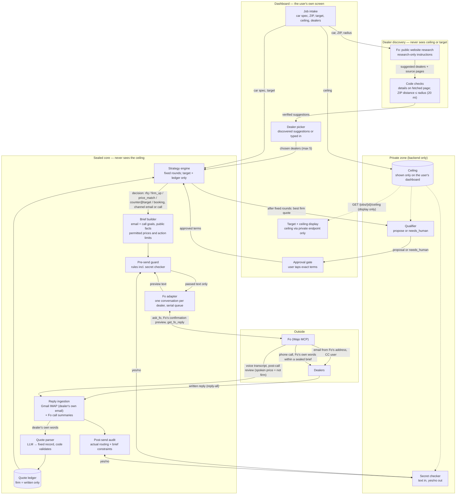
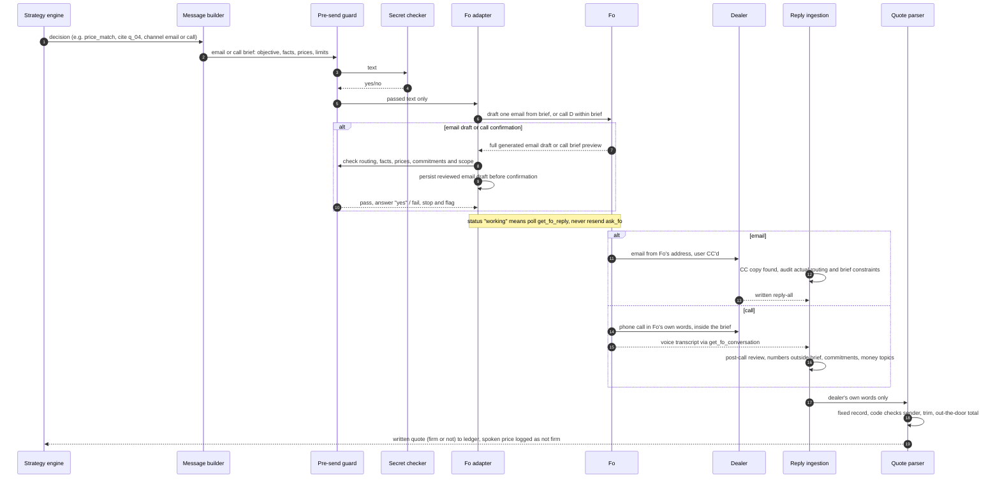

# Sealed — architecture ("sealed envelope")

Status: updated 2026-10-18 for Fo email briefs and Fo-first dealer discovery (decision 14 revised). Supersedes `docs/sealed_module_io_flow.png`. API and event contract: `docs/api.md`; email contract: `docs/fo_briefs.md`; discovery operation: `docs/dealer_discovery.md`.

Launch scenario: buying one specific car from several dealers (see `docs/research/problem.md`).

## 1. The idea

Fo does the outreach on its own channels: **email and phone calls**. Sealed authorizes each action and supplies a brief with permitted public facts and price roles; Fo chooses natural wording. For email, code checks the full generated draft before confirming it. **No outgoing brief, offer or strategy decision is computed from the ceiling.** Outgoing prices are only:

- a dealer's own quote,
- the lowest written competing quote (true, from the ledger), or
- the user's **target**, which is public, fixed when the job is created, and never moves.

So the ceiling cannot leak through what we send or say, even indirectly ("offer drift"). Inside the backend it is used in exactly one place: after a fixed number of rounds, a small qualifier decides whether the best firm quote is good enough to *propose to the user*, or whether to raise `job.needs_human`. That decision is output only as "proposal" or "needs human", never as a number or a gap.

The user can **see their own ceiling and target on the dashboard**. The ceiling reaches the dashboard through one private endpoint (`GET /jobs/{id}/ceiling`), never through events, so the event log and everything sent to Fo stay ceiling-free. Fo, dealers and every LLM never see it.

Dealers can be **typed in by the user or discovered**: Fo researches public websites and suggests dealers for the car near the user's ZIP, code keeps only those within the radius (20 miles in v1) whose contact details appear word for word on a fetched page, and the user picks up to 5. Discovery contacts no one.

Calls are a core channel with two jobs: nudge silent dealers to send a written quote, and carry the true lowest written total to a dealer in round 2. **A spoken price is never a firm quote**; only written replies enter the ledger as firm.

The secret checker and pre-/post-send checks stay as defence in depth.

Step 1 validation rules: a firm quote needs a matching configured dealer sender, a finite positive total present in the dealer's text, the job's currency and specification, and no hedge or decline. Strategy and qualification use only the latest sender-matched written reply per dealer, so a withdrawal or non-firm revision retires an older offer. Historical quotes remain available for evidence and the first-quote savings baseline. A dealer update invalidates its pending proposal; booking completion requires a confirmation linked to the sent booking with the exact approved terms. The guard scans outgoing briefs and generated drafts, requires exact routing, and checks disclosure, specification, permitted numbers/price roles, commitments and known unsupported claims/actions. Compliant rewording and ordinary signatures are allowed. These are conservative rules, not semantic proof of arbitrary prose; ambiguous or unsupported formats require review. Legacy exact-email and call preview checks remain strict.

## 2. System diagram

## 3. Who knows what

| Component | Ceiling | Target | Dealer quotes | Notes |
|---|---|---|---|---|
| Dashboard (the user's own screen) | **Yes, display only** (`GET /jobs/{id}/ceiling`) | Yes | Yes | Never in events/SSE; never stored in `localStorage` or URLs; never sent on in any request. |
| Dealer discovery (Fo) | **No** | **No** | No | Gets only car, ZIP, radius. Research-only instructions; Fo tools are not mechanically restricted. Code checks public sources and contacts. |
| Ceiling vault | **Yes** | — | — | Backend memory/env only. Not logged. |
| Secret checker | **Yes** | — | — | Text in, yes/no out. Defence in depth. |
| Qualifier | **Yes** | Yes | Best firm quote only | Outputs `propose` or `needs_human`. Runs once, after the fixed rounds. |
| Strategy engine | **No** | Yes | Yes | Fixed round plan; offers are only target or a real ledger quote. |
| Brief builder | No | Only if offered | Ledger values | No LLM. Fo composes from the public brief. |
| Call brief | **No** | No | Only the lowest written total (round 2) | Goal + allowed facts + fixed hard limits; Fo talks in its own words inside it. Guarded before the call; transcript reviewed after. |
| Pre-send guard | No (asks checker) | If offered | Allowed values | Checks the brief and Fo's generated draft against routing, price roles and constraints. |
| Fo adapter / Fo | No | Only if a counter is sent | Only what a message or brief states | One Fo conversation per dealer. Fo has durable memory (CLAIMED), so nothing secret is ever given to it. |
| Quote parser | No | No | Yes | Untrusted input → strict record with evidence; code validates. Implemented in `sealed/parser/quote.py`; [read-only preview and limits](quote_parser.md). Engine delivery remains separate. |
| Each dealer | No | Only if countered | Its own + best competing total (no dealer name) | All true. |

## 4. Round plan (fixed, never depends on the ceiling)

| Round | Who | Channel | Message kind | Content |
|---|---|---|---|---|
| 1 | every dealer with an email | email | `rfq` | Exact car (model, trim, color), zip, timeline, ask for a written **out-the-door** total. |
| 1 | phone-only dealers (no email on file) | **call** | `rfq` | "I'm Fo, calling for a buyer about [exact car]. Could you email the out-the-door total to [buyer's address]?" Counts as their call nudge. Later emails go to the first sender that trusted ingestion attributes to this dealer's call. An unknown sender alone never establishes identity. |
| 1 | dealers with no email reply after a fixed wait (e.g. 3 h, set at job creation) | **call** | `rfq` (call nudge) | Sealed brief. Goal: get a written out-the-door total emailed. Facts: car, ZIP, timeline, buyer's first name, "we emailed and have no reply yet". Once per dealer. |
| 1b | dealers whose written reply is not firm | email | `firm_up` | "Please send the out-the-door total including all fees and taxes." Once. |
| 2 | every dealer with a firm quote that is not the lowest | email | `price_match` | "Your total is $X. The lowest written out-the-door total so far is $Y. Would you like to revise?" |
| 2 | same dealers (optional, fixed rule: dealers that didn't answer the round-2 email after the wait) | **call** | `price_match` (call) | Sealed brief. Goal: tell them the lowest written total ($Y) and ask for a revised written total by email. No new numbers, no agreement. |
| 2 | the dealer holding the lowest quote | email | `counter` (optional) | "Could you do $target out-the-door?" Target is fixed; sent only if target < lowest quote. |
| end | — | — | qualifier | Best firm quote → `propose` or `needs_human`. |
| after approval | winner | email | `booking` | "The buyer would like to proceed at $Z. Please send the purchase paperwork." No payment through Fo. |
| after approval | others | email | `cancel` | Polite decline. |

Whether a call or round 2 happens never depends on the ceiling, so the timing of messages and calls reveals nothing. A price heard on a call is logged (`quote.parsed`, `firm: false`, source `call`) and triggers nothing until the dealer puts it in writing.

## 5. One send, step by step

## 6. Trust boundaries

1. **Ceiling → anything outgoing.** No outgoing number is computed from it (by construction). The secret checker is a second line, before and after sending.
2. **Sealed → Fo.** Public briefs cross; raw seller instructions and the private ceiling do not. Fo composes one email and returns an explicit draft envelope. Code checks it and saves it before confirming. Reported sending without a reviewed draft pauses the account without resending. Compliant wording and ordinary signatures are allowed. The Gmail sent-copy auditor now validates actual routing, sender authentication and full inline text alternatives; its callback keeps a durable sent reservation active until verification. The controlled brief command wires this path, and the background coordinator connects dispatch with polling and durable timers; the local API and dashboard now connect to this worker. No claim is made that the rule checker proves every natural-language fact. Fo claims durable memory across conversations, so the rule "never mention a budget to Fo, in any form" covers every chat, test and manual use of the account.
3. **Dealers → Sealed.** Written replies and call summaries are untrusted. They become a fixed record validated by code and never reach Fo or any prompt that can act. `suspicious_instructions` raises a flag.
4. **Dashboard.** The ceiling crosses to the browser only on `GET /jobs/{id}/ceiling` (`no-store`). The dashboard never talks to Fo, so showing the ceiling there gives Fo no path to it. Shown on screen means visible to anyone looking at it (e.g. a recorded demo); that is the user's choice.
5. **Dealer websites → discovery.** Web pages are untrusted (could contain instructions or wrong details). Discovery receives no ceiling or target and is instructed to perform public research only; Fo tool isolation is not mechanically enforced; code keeps an email/phone/address only if it appears literally on a fetched page, recomputes the distance from the address ZIP, and the user picks who is contacted.
6. **Calls.** A call **cannot leak the ceiling**: Fo never has it, and the brief contains only ledger facts. Fo runs the conversation in its own words inside a **sealed brief**: a goal (get a written total emailed), the only facts it may use, and fixed hard limits (say it's an AI assistant; no agreeing, reserving, ordering or paying; no payment details; no numbers outside the brief; no follow-ups; questions about spending or deposits get one fixed answer). The guard checks the brief before the call. After the call, the **post-call review** reads the voice transcript and flags any number Fo said that isn't in the brief, any commitment wording from Fo, and any mention of budget, deposit or payment by either side; flags raise `job.needs_human` (`call_review`). Only written quotes count; spoken prices stay `firm: false`. Call recording/consent is the user's responsibility under Wajo's terms; see `docs/threat_model.md`.

## 7. Fo-specific decisions (from spikes and the official spec)

- **Fo's voice.** Fo refuses to send text written as the user (spike 1b, VERIFIED). Briefs require Fo to identify itself as an AI assistant acting for the buyer; generated wording may vary.
- **One Fo conversation per dealer** (`newConversation: true` on the first send; store the id). Calls to that dealer go in the same conversation.
- **Serial send queue.** One `ask_fo` turn at a time per account (spike + spec). Calls and emails share the queue.
- **No duplicate sends or calls.** On timeout or `working`, poll `get_fo_reply`. Never resend `ask_fo` for the same `message_id`.
- **Replies.** Gmail IMAP is the source of truth for written replies: `get_fo_conversation` on the email-channel conversation created by a vendor reply returned **0 turns** (VERIFIED twice). Fo CLAIMS replies "arrive back in this thread"; spike 1c watches the per-dealer conversation to test that. If it holds, it becomes a second read path, not a replacement.
- **Webhook.** A `conversation.reply` webhook is DOCUMENTED in the separate Wajo agent MCP (`https://mcp.api.wajo.ai/mcp`, `register_webhook`), needs a public HTTPS URL, and carries Fo's final message (max 2,000 chars), not the dealer's raw email. Not used; polling stays.
- **Token.** `auth.py` refreshes before expiry; refresh tokens rotate and are saved immediately.

Adapter implementation details: run one process with one persistent state file per account. Its account lock covers reservation, the whole Fo turn, configured Gmail auditing and final status; state is reloaded inside the lock and written by atomic replacement. Message keys include job/run/message and a payload fingerprint; conversation keys include job/run/dealer. IDs learned during polling are saved before answering a preview. Unresolved or flagged turns leave a persistent active marker requiring review. A single async owner task creates, uses, reconnects and closes the MCP session, so token rotation preserves SDK context ownership. Controlled live acceptance instructions are in `docs/fo_adapter.md` and `docs/sent_audit.md`; the new brief-mode send is prepared but not yet run.

## 8. Changes vs the earlier design and API

| Area | Earlier | New | Breaking for the dashboard? |
|---|---|---|---|
| Ceiling use | Strategy engine sees it; counters move toward it | Only the qualifier sees it; counters fixed at target | No |
| `strategy.decided.offer` | Any number | Always equals `target` (or null) | No (same field) |
| `guard.checked` | One per message | Can appear twice per message; add optional `stage: "pre_send" \| "fo_preview"` | No (new optional field) |
| `message.sent` | Email only | Add optional `channel: "email" \| "call"`; `kind` unchanged; for calls `body` holds the sealed brief | No (new optional field) |
| Email content (decision 16) | Exact template | Fo-composed draft; `brief` and `content_source` are added. Unknown delivered body is represented by empty `body`, never the brief. | UI should distinguish reviewed preview from delivered evidence. |
| Email audit (decision 16) | Body equality | `basis: "brief_constraints"`: compliance with routing and authorized content; ordinary signatures allowed. | Field names stay; `matched` uses the declared basis. |
| `job.needs_human` | — | New reason `call_review` with `flags: [{flag, speaker, excerpt}]` after a call | No (new value) |
| `quote.parsed` | Written replies | A spoken price arrives with `firm: false` and `source: "call"` | No (new optional field) |
| Message voice | "Hi …, Thank you, Het" | Written as Fo on the buyer's behalf | No |
| Scenario | Hoodies | One car, `spec.quantity: 1`, `spec.details` = model/trim/color; prices are out-the-door totals | Mock data only |
| `booking` | Order the item | "Proceed, please send paperwork" (no payment) | No |
| Dashboard | Never sees ceiling | Shows the user's own ceiling and target; ceiling fetched from `GET /jobs/{id}/ceiling` only, never in events | No (new endpoint) |
| Dealers | Typed in by the user | Typed in, or discovered (`POST /dealers/discover`, 20-mile radius in v1; 10/50 later) and picked by the user | No (new endpoint; optional `zip`, vendor `phone`, `source`) |

Everything else in `docs/api.md` stays as is.

### Dealer discovery, step by step

1. User enters car, spec and ZIP (radius fixed at 20 miles in v1).
2. Backend submits a durable background research turn through existing Fo MCP, with no ceiling, target or buyer identity. The prompt forbids outreach, scheduling, private account access and documents. Fo's tool set is not mechanically restricted by this integration.
3. Code independently fetches official HTTPS sources, checks published name/address/contact evidence and filters unsupported contacts. Redirect, public DNS, TLS and response-size checks constrain reads.
4. Code looks up ZIP centroids through the public key-free Zippopotam.us API and computes approximate straight-line distances, dropping candidates outside 20 miles. There is no offline ZIP table. Inventory remains unconfirmed.
5. Dashboard polls saved progress and lets the user select up to five sellers total. Job creation binds contacts and requirements to a checked result no older than one hour; outreach starts separately. Simulation uses synthetic candidates with no external clients.

See [Fo discovery operation, API and limits](dealer_discovery.md).
Radius options **10 and 50 miles** are added after the core flow and dashboard are built; until then the API accepts only 20.

## 9. Open checks before building

- Discovery: how many local dealers publish a sales email (vs contact forms only)? Dealers without one can only be called.

- ~~A1: does `get_fo_conversation` on an `email` conversation include the dealer's reply?~~ No (0 turns, VERIFIED). Gmail IMAP is the read path.
- Spike 1c: does Fo send a Fo-voice body verbatim, does the preview contain the full draft, and does the reply show up in the per-dealer Fo conversation (Fo's claim)?
- Spike 1d: does a text request make Fo place a call, does it stay on the script (done: yes, mostly; see spike 1d), and does a transcript or summary come back through MCP?
- `working` + `get_fo_reply` path: not yet observed (all turns so far returned `complete` in one call).

## 10. Background coordinator implementation (2026-10-18)

`sealed/service/coordinator.py` injects the Gmail reader, isolated extractor,
private checker/qualifier callbacks and transport. It persists public checkpoints,
outbox intents and timer claims; it never receives the private ceiling itself.
A cycle polls and applies replies before dispatch and timer transitions. Missing
private runtime, unavailable parsing, mail failures and uncertain sends block
progress. Only the CLI composition root binds private callbacks; service logic
may not import private modules. The private vault is restored through hidden
terminal input after restart, never from a public checkpoint.

The worker is an explicit CLI, not an automatically launched process. Its offline
acceptance completes a synthetic $100-to-$90 negotiation through explicit approval
and written confirmation, then verifies restart replay. HTTP/SSE, job intake, approval controls and the dashboard are now wired through
`app/main.py` and `app/jobs.py`; reviewed reconciliation remains; Fo discovery is implemented (see dealer_discovery.md). See [coordinator usage and limits](coordinator.md).

## 11. Local API worker and dashboard (2026-10-18)

FastAPI owns one account executor and coordinator worker for its lifespan. SQLite
connections and engine mutations stay on that executor thread; SSE reads replay
persisted ordered events and then follow updates. Only the composition root accepts
private ceiling input and binds private callbacks. Validation errors never echo
request values. The ceiling is not persisted; restart requires explicit restoration.

Job creation records a public checkpoint without starting outreach. Start permissions
are durable and scoped to one job; only started jobs are ticked. Live API and CLI
workers share a Fo account lock, and each API database also has a process lock.
Simulated API mail and virtual time are durable but construct no live clients.

The React dashboard defaults to this API, shows simulation/live labels, obtains the
ceiling through the private endpoint only, and echoes exact proposal terms for
approval. Explicit Origin checks complement CORS to prevent cross-site writes to
the unauthenticated loopback API. See [dashboard operations](dashboard.md).
