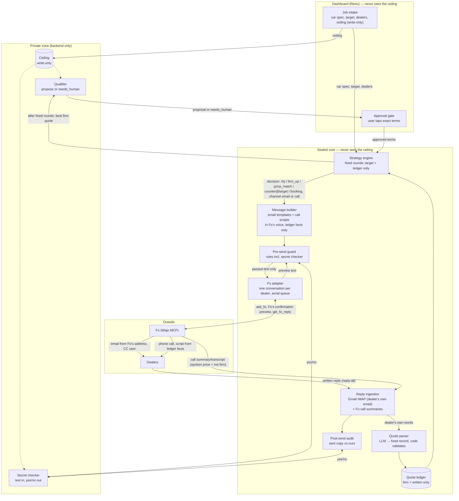
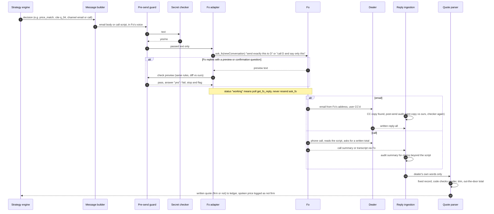

# Sealed — architecture ("sealed envelope")

Status: decided, 2026-10-17. Supersedes `docs/sealed_module_io_flow.png`. Keeps the API and event contract in `docs/api.md` (v0.1); the additive changes are listed in section 8.

Launch scenario: buying one specific car from several dealers (see `docs/research/problem.md`).

## 1. The idea

Fo does the outreach on its own channels: **email and phone calls**. Plain, deterministic code decides every fact that goes out, in an email or on a call. **Nothing that leaves Sealed is ever computed from the ceiling.** Outgoing prices are only:

- a dealer's own quote,
- the lowest written competing quote (true, from the ledger), or
- the user's **target**, which is public, fixed when the job is created, and never moves.

So the ceiling cannot leak through what we send or say, even indirectly ("offer drift"). It is used in exactly one place: after a fixed number of rounds, a small qualifier decides whether the best firm quote is good enough to *propose to the user*, or whether to raise `job.needs_human`. That decision only reaches the user, and only as "proposal" or "needs human", never as a number or a gap.

Calls are a core channel with two jobs: nudge silent dealers to send a written quote, and carry the true lowest written total to a dealer in round 2. **A spoken price is never a firm quote**; only written replies enter the ledger as firm.

The secret checker and pre-/post-send checks stay as defence in depth.

## 2. System diagram

## 3. Who knows what

| Component | Ceiling | Target | Dealer quotes | Notes |
|---|---|---|---|---|
| Dashboard | **Never** (write-only on `POST /jobs`) | Yes | Yes | Unchanged rule from `api.md`. |
| Ceiling vault | **Yes** | — | — | Backend memory/env only. Not logged. |
| Secret checker | **Yes** | — | — | Text in, yes/no out. Defence in depth. |
| Qualifier | **Yes** | Yes | Best firm quote only | Outputs `propose` or `needs_human`. Runs once, after the fixed rounds. |
| Strategy engine | **No** | Yes | Yes | Fixed round plan; offers are only target or a real ledger quote. |
| Message builder | No | Yes | Ledger values | No LLM. Fo's voice. |
| Call script | **No** | Only in a round-2 counter (not used on calls by default) | Only the dealer's own total and the lowest written total | Built from ledger facts only; says "please email", never agrees to anything. |
| Pre-send guard | No (asks checker) | Yes | Allowed values | Checks our text/script **and** Fo's preview. |
| Fo adapter / Fo | No | Only if a counter is sent | Only what a message or script states | One Fo conversation per dealer. Fo has durable memory (CLAIMED), so nothing secret is ever given to it. |
| Quote parser | No | No | Yes | Untrusted input → fixed record. |
| Each dealer | No | Only if countered | Its own + best competing total (no dealer name) | All true. |

## 4. Round plan (fixed, never depends on the ceiling)

| Round | Who | Channel | Message kind | Content |
|---|---|---|---|---|
| 1 | every dealer | email | `rfq` | Exact car (model, trim, color), zip, timeline, ask for a written **out-the-door** total. |
| 1 | dealers with no email reply after a fixed wait (e.g. 3 h, set at job creation) | **call** | `rfq` (call nudge) | "I'm Fo, an AI assistant calling for a buyer about [exact car]. I emailed asking for an out-the-door total. Could you please reply to that email with the total?" Once per dealer. |
| 1b | dealers whose written reply is not firm | email | `firm_up` | "Please send the out-the-door total including all fees and taxes." Once. |
| 2 | every dealer with a firm quote that is not the lowest | email | `price_match` | "Your total is $X. The lowest written out-the-door total so far is $Y. Would you like to revise?" |
| 2 | same dealers (optional, fixed rule: dealers that didn't answer the round-2 email after the wait) | **call** | `price_match` (call) | "The lowest written out-the-door total so far is $Y. If you'd like to revise yours, please send it by email." No agreement, no new numbers. |
| 2 | the dealer holding the lowest quote | email | `counter` (optional) | "Could you do $target out-the-door?" Target is fixed; sent only if target < lowest quote. |
| end | — | — | qualifier | Best firm quote → `propose` or `needs_human`. |
| after approval | winner | email | `booking` | "The buyer would like to proceed at $Z. Please send the purchase paperwork." No payment through Fo. |
| after approval | others | email | `cancel` | Polite decline. |

Whether a call or round 2 happens never depends on the ceiling, so the timing of messages and calls reveals nothing. A price heard on a call is logged (`quote.parsed`, `firm: false`, source `call`) and triggers nothing until the dealer puts it in writing.

## 5. One send, step by step

## 6. Trust boundaries

1. **Ceiling → anything outgoing.** No outgoing number is computed from it (by construction). The secret checker is a second line, before and after sending.
2. **Sealed → Fo.** Only template text and call scripts cross. Fo's preview is checked at the confirmation step; the sent email copy is audited after. Fo claims durable memory across conversations, so the rule "never mention a budget to Fo, in any form" covers every chat, test and manual use of the account.
3. **Dealers → Sealed.** Written replies and call summaries are untrusted. They become a fixed record validated by code and never reach Fo or any prompt that can act. `suspicious_instructions` raises a flag.
4. **Calls.** A call **cannot leak the ceiling**: Fo never has it, and the script contains only ledger facts. The real risk is **untrue or unauthorised statements** (Fo says it works "from a brief, not a rigid script", CLAIMED). Handled by: a short script with only true facts and one ask ("please email the total"); an explicit "do not agree to anything"; auditing Fo's call summary for claims beyond the script; and accepting **only written quotes** as firm. Call recording/consent is the user's responsibility under Wajo's terms; see `docs/threat_model.md`.

## 7. Fo-specific decisions (from spikes and the official spec)

- **Fo's voice.** Fo refuses to send text written as the user (spike 1b, VERIFIED). Templates and scripts say "I'm Fo, an AI assistant writing/calling on behalf of [buyer]".
- **One Fo conversation per dealer** (`newConversation: true` on the first send; store the id). Calls to that dealer go in the same conversation.
- **Serial send queue.** One `ask_fo` turn at a time per account (spike + spec). Calls and emails share the queue.
- **No duplicate sends or calls.** On timeout or `working`, poll `get_fo_reply`. Never resend `ask_fo` for the same `message_id`.
- **Replies.** Gmail IMAP is the source of truth for written replies: `get_fo_conversation` on the email-channel conversation created by a vendor reply returned **0 turns** (VERIFIED twice). Fo CLAIMS replies "arrive back in this thread"; spike 1c watches the per-dealer conversation to test that. If it holds, it becomes a second read path, not a replacement.
- **Webhook.** A `conversation.reply` webhook is DOCUMENTED in the separate Wajo agent MCP (`https://mcp.api.wajo.ai/mcp`, `register_webhook`), needs a public HTTPS URL, and carries Fo's final message (max 2,000 chars), not the dealer's raw email. Not used; polling stays.
- **Token.** `auth.py` refreshes before expiry; refresh tokens rotate and are saved immediately.

## 8. Changes vs the current design and API (for Het and Renu)

| Area | Current | New | Breaking for Renu? |
|---|---|---|---|
| Ceiling use | Strategy engine sees it; counters move toward it | Only the qualifier sees it; counters fixed at target | No |
| `strategy.decided.offer` | Any number | Always equals `target` (or null) | No (same field) |
| `guard.checked` | One per message | Can appear twice per message; add optional `stage: "pre_send" \| "fo_preview"` | No (new optional field) |
| `message.sent` | Email only | Add optional `channel: "email" \| "call"`; `kind` unchanged; for calls `body` holds the script | No (new optional field) |
| `quote.parsed` | Written replies | A spoken price arrives with `firm: false` and `source: "call"` | No (new optional field) |
| Message voice | "Hi …, Thank you, Het" | Written as Fo on the buyer's behalf | No |
| Scenario | Hoodies | One car, `spec.quantity: 1`, `spec.details` = model/trim/color; prices are out-the-door totals | Mock data only |
| `booking` | Order the item | "Proceed, please send paperwork" (no payment) | No |
| Dashboard | Never sees ceiling | Same | No |

Everything else in `docs/api.md` stays as is.

## 9. Open checks before building

- ~~A1: does `get_fo_conversation` on an `email` conversation include the dealer's reply?~~ No (0 turns, VERIFIED). Gmail IMAP is the read path.
- Spike 1c: does Fo send a Fo-voice body verbatim, does the preview contain the full draft, and does the reply show up in the per-dealer Fo conversation (Fo's claim)?
- Spike 1d: does a text request make Fo place a call, does it stay on the script, and does a transcript or summary come back through MCP?
- `working` + `get_fo_reply` path: not yet observed (all turns so far returned `complete` in one call).
