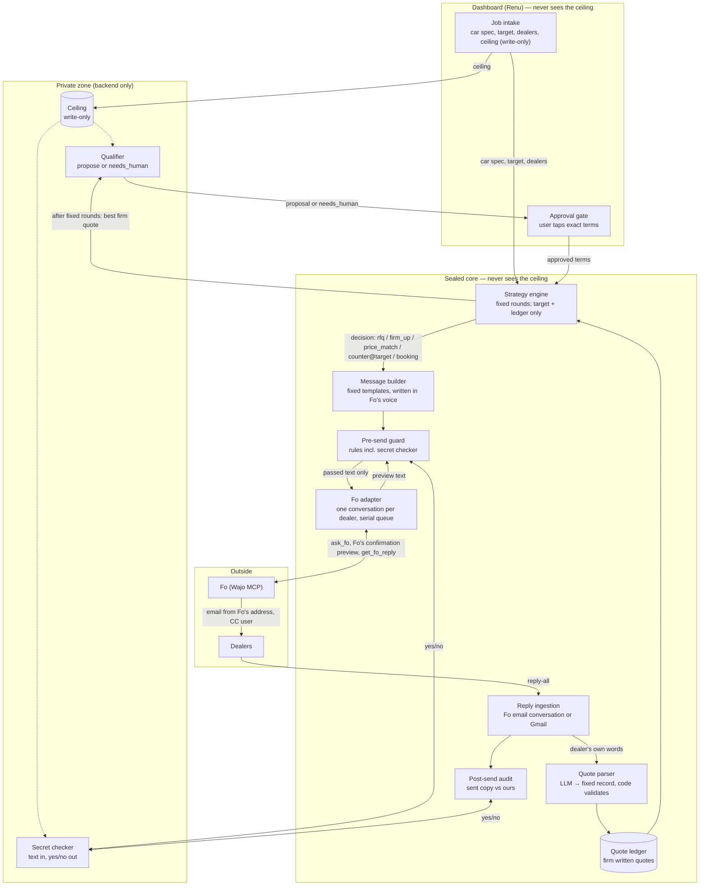
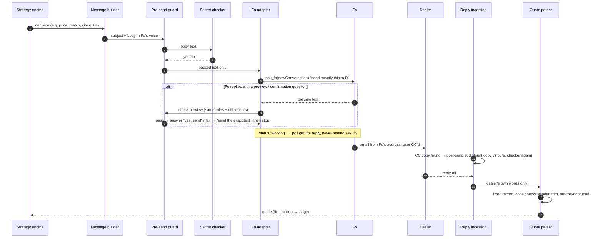

# Sealed — architecture ("sealed envelope")

Status: design, 2026-10-17. Builds on `docs/sealed_module_io_flow.png` and `docs/api.md` (v0.1). Keeps the API and event contract; the changes are listed in section 8.

Launch scenario: buying one specific car from several dealers (see `docs/research/problem.md`).

## 1. The idea

Fo does the outreach on its own channels (email, and phone nudges if they work). Plain, deterministic code decides every fact that goes out. **Nothing that leaves Sealed is ever computed from the ceiling.** Outgoing prices are only:

- a dealer's own quote,
- the lowest written competing quote (true, from the ledger), or
- the user's **target**, which is public, fixed when the job is created, and never moves.

So the ceiling cannot leak through what we send, even indirectly ("offer drift"). It is used in exactly one place: after a fixed number of rounds, a small qualifier decides whether the best firm quote is good enough to *propose to the user*, or whether to raise `job.needs_human`. That decision only reaches the user, and only as "proposal" or "needs human", never as a number or a gap.

The secret checker and pre-/post-send checks from the current design stay as defence in depth.

## 2. System diagram

## 3. Who knows what

| Component | Ceiling | Target | Dealer quotes | Notes |
|---|---|---|---|---|
| Dashboard | **Never** (write-only on `POST /jobs`) | Yes | Yes | Unchanged rule from `api.md`. |
| Ceiling vault | **Yes** | — | — | Backend memory/env only. Not logged. |
| Secret checker | **Yes** | — | — | Text in, yes/no out. Defence in depth. |
| Qualifier | **Yes** | Yes | Best firm quote only | Outputs `propose` or `needs_human`. Runs once, after the fixed rounds. |
| Strategy engine | **No** (changed) | Yes | Yes | Fixed round plan; offers are only target or a real ledger quote. |
| Message builder | No | Yes | Ledger values | No LLM. Fo's voice. |
| Pre-send guard | No (asks checker) | Yes | Allowed values | Checks our text **and** Fo's preview. |
| Fo adapter / Fo | No | Only if a counter is sent | Only what a message states | One Fo conversation per dealer. |
| Quote parser | No | No | Yes | Untrusted input → fixed record. |
| Each dealer | No | Only if countered | Its own + best competing total (no dealer name) | All true. |

## 4. Round plan (fixed, never depends on the ceiling)

| Round | Who | Message kind | Content |
|---|---|---|---|
| 1 | every dealer | `rfq` | Exact car (model, trim, color), zip, timeline, ask for a written **out-the-door** total. |
| 1b | dealers whose reply is not firm | `firm_up` | "Please send the out-the-door total including all fees and taxes." Once. |
| 2 | every dealer with a firm quote that is not the lowest | `price_match` | "Your total is $X. The lowest written out-the-door total so far is $Y. Would you like to revise?" |
| 2 | the dealer holding the lowest quote | `counter` (optional) | "Could you do $target out-the-door?" Target is fixed; sent only if target < lowest quote. |
| end | — | qualifier | Best firm quote → `propose` or `needs_human`. |
| after approval | winner | `booking` | "The buyer would like to proceed at $Z. Please send the purchase paperwork." No payment through Fo. |
| after approval | others | `cancel` | Polite decline. |

Whether round 2 happens never depends on the ceiling, so the timing of messages reveals nothing.

## 5. One send, step by step

## 6. Trust boundaries

1. **Ceiling → anything outgoing.** No outgoing number is computed from it (by construction). The secret checker is a second line, before and after sending.
2. **Sealed → Fo.** Only template text crosses. Fo's preview is checked again at the confirmation step; the sent copy is audited after.
3. **Dealers → Sealed.** Replies are untrusted. They become a fixed record validated by code and never reach Fo or any prompt that can act. `suspicious_instructions` raises a flag (existing event field).
4. **Calls.** If used, a call is only a nudge ("please email your out-the-door total"). Only written quotes enter the ledger; Fo relays stay `UNVERIFIED` (existing rule).

## 7. Fo-specific decisions (from spikes and the official spec)

- **Fo's voice.** Fo refuses to send text written as the user (spike 1b). Templates are written as "I'm Fo, an AI assistant writing on behalf of [buyer]".
- **One Fo conversation per dealer** (`newConversation: true` on the first send; store the id).
- **Serial send queue.** One `ask_fo` turn at a time per account (spike + spec).
- **No duplicate sends.** On timeout or `working`, poll `get_fo_reply`. Never resend `ask_fo` for the same `message_id`.
- **Replies.** Try Fo's `email`-channel conversations via `get_fo_conversation` first (untested); fall back to Gmail IMAP (spike 2, written but not run).
- **Token.** `auth.py` refreshes before expiry; refresh tokens rotate and are saved immediately.

## 8. Changes vs the current design and API (for Het and Renu)

| Area | Current | New | Breaking for Renu? |
|---|---|---|---|
| Ceiling use | Strategy engine sees it; counters move toward it | Only the qualifier sees it; counters fixed at target | No |
| `strategy.decided.offer` | Any number | Always equals `target` (or null) | No (same field) |
| `guard.checked` | One per message | Can appear twice per message; add optional `stage: "pre_send" \| "fo_preview"` | No (new optional field) |
| Message voice | "Hi …, Thank you, Het" | Written as Fo on the buyer's behalf | No |
| Scenario | Hoodies | One car, `spec.quantity: 1`, `spec.details` = model/trim/color; prices are out-the-door totals | Mock data only |
| `booking` | Order the item | "Proceed, please send paperwork" (no payment) | No |
| Dashboard | Never sees ceiling | Same | No |

Everything else in `docs/api.md` stays as is.

## 9. Open checks before building

- A1: does `get_fo_conversation` on an `email` conversation include the dealer's reply?
- Does Fo send a Fo-voice body verbatim? (Rerun spike 1b with the new template.)
- Does Fo's confirmation turn contain the full draft? If not, rely on the post-send audit.
- Outbound calls: does a text request make Fo call, and does a transcript come back?
