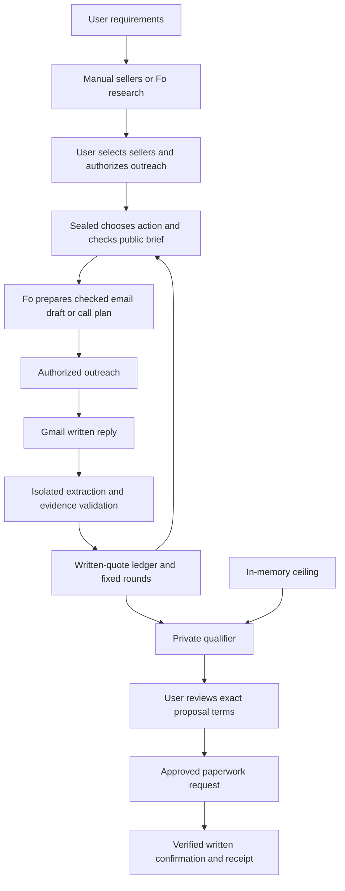

# Sealed implementation and validation report

Prepared October 18, 2026. Implementation snapshot: `main` at `941a591`.

Sealed now connects dealer selection, guarded outreach, written-quote processing,
negotiation, explicit buyer approval and written confirmation through a local
dashboard and durable backend. Its complete synthetic workflow passes automated
and browser checks. Individual integrations have also been exercised with live
services. A fresh live acceptance of the checked call protocol and a complete live
dashboard negotiation remain outstanding.

This report covers the work represented by the current repository and the
recorded session evidence. Historical live tests are identified separately from
synthetic tests; the report does not establish current vehicle availability or
the current health of external services. Credentials, customer ceilings, raw
messages and private provider conversation identifiers are excluded.

## Product and architecture

The initial use case is purchasing one specified car from up to five sellers.
The user supplies the specification, ZIP, deadline, public target and private
ceiling. Sellers can be entered manually or selected from discovery results.

The implementation assigns distinct responsibilities:

| Component | Responsibility | Main implementation |
|---|---|---|
| React dashboard | Intake, dealer selection, progress, evidence, approval and receipt | `frontend/src/` |
| FastAPI application | Local HTTP/SSE interface and worker lifecycle | `backend/app/` |
| Negotiation engine | Fixed rounds, quote authority, action selection and approval state | `backend/sealed/core/` |
| Private runtime | In-memory ceiling, secret checks and proposal qualification | `backend/sealed/private/` |
| Fo adapter | Checked email drafts, call plans, account serialization and provider state | `backend/sealed/fo/` |
| Gmail ingestion and auditing | Authenticated written evidence, sent copies and reply linkage | `backend/sealed/ingest/` |
| Quote parser | Tool-free Claude extraction followed by deterministic evidence checks | `backend/sealed/parser/` |
| Coordinator | Polling, delivery, timers, guarded dispatch and recovery | `backend/sealed/service/` |
| Dealer discovery | Background research, public-source checks, distance filtering and saved selections | `backend/sealed/discovery/` |

Fo chooses natural wording within an authorized brief. Sealed decides which
action is permitted, which facts and prices it may use, and when to stop for
approval or review. Claude extracts seller terms without outreach tools.

## Negotiation logic and private ceiling

We implemented and connected the fixed two-round strategy:

1. Request a written out-the-door total for the specified car. A phone-only
   seller can receive an authorized call requesting a written quote.
2. Ask once for clarification when the written reply is insufficiently firm.
   After fixed waits, eligible silent sellers can receive a call nudge.
3. During round two, tell higher-priced sellers the lowest genuine competing
   written total. Ask a seller holding the lowest total for the public target
   when that target is lower than its quote.
4. At the end of the rounds, privately qualify the available written offers and
   present a proposal or request human review.
5. Require the user's exact-term approval before requesting purchase paperwork.
   Complete only after the seller's verified written confirmation.

For the controlled example, a $100 written quote and $90 public target produce a
$90 counter. The system does not repeatedly increase its offer or bargain
indefinitely until the target is reached. A qualifying final offer can be above
the target and still require the user's approval.

The ceiling is held in backend memory and excluded from public job records,
events, checkpoints and outreach. The strategy has no ceiling parameter. The
private qualifier uses it to decide whether to propose an offer; the checker
uses it for disclosure detection. The user's dashboard obtains it through a
dedicated private endpoint and keeps it out of browser storage. Restarting the
backend clears that memory, so further authorized job actions can require
restoration. Observing an already authorized pending call can continue without
restoring the ceiling.

## Fo connection and email delivery

We implemented the MCP adapter with one owned async session behind synchronous
methods, reconnect/cleanup behavior, OAuth refresh support and direct API-key
authentication. A configured `FO_API_KEY` takes precedence over OAuth. Key
rejection does not silently switch accounts through OAuth fallback. Credentials
remain in ignored local configuration and are excluded from frontend settings.

New emails use a structured public brief rather than requiring Fo to deliver an
exact template. Fo must return a draft before sending. Code checks the recipient,
CC, subject, AI disclosure, specification, authorized price roles, commitments and
action scope. Ordinary compliant signatures and rewording are allowed.

We added Gmail auditing of the actual sent copy. A reviewed draft alone is not
delivery evidence. The auditor checks routing, authentication and content against
the brief and saves the real reply/thread bindings. An uncertain or mismatched
result retains its review state instead of triggering another send.

Recorded live evidence includes an initial controlled email and a later $90
counter in the original test conversation. The counter passed draft review and
all 26 actual-copy audit rules. The earlier exact-template test retained its
signature-only mismatch as history; reviewing it did not erase that evidence or
resend the email. API-key authentication was separately checked with two
read-only conversation-list requests through the same client.

See [Fo adapter](fo_adapter.md), [email briefs](fo_briefs.md) and
[sent-copy auditing](sent_audit.md).

## Written replies, parsing and durable processing

Gmail IMAP supplies the written source evidence. Ingestion associates replies
using trusted subject/reply/thread bindings, checks the configured seller and
Gmail authentication evidence, strips common quoted history, and stages messages
with durable deduplication. An unknown sender or subject tag alone does not
establish a phone-only dealer's identity.

The isolated Claude parser receives cleaned reply text and limited public parsing
context. It receives neither the target nor ceiling and has no acting tools.
Its structured output includes evidence spans; code checks amounts, all-in terms,
specification, dates, validity and itemized costs against the actual text.
Ambiguous or unsupported evidence cannot become firm merely because the model
labels it firm.

A user-authorized live parser test extracted the $95 sample's total, all-in terms,
availability and validity. Its missing specification confirmation correctly
prevented a firm result. Durable handoff then applied the cached real reply once
and queued one clarification. Immediate/restart replay did not create duplicate
quotes or outreach; that handoff test sent nothing.

We connected ingestion and parsing to SQLite checkpoints, events and a guarded
outbox. Reply effects commit before inbox acknowledgment. Outbound claims commit
before external dispatch. Historical or superseded replies cannot silently
replace newer authoritative terms, and changed seller terms invalidate stale
approval. An ambiguous external outcome is preserved for reconciliation.

See [Gmail ingestion](gmail_ingestion.md), [quote parser](quote_parser.md) and
[durable delivery](reply_delivery.md).

## Dealer discovery

We added **Find dealers** to the intake form. In live mode, Fo researches public
dealership websites using the item, specification, ZIP and 20-mile radius. Target,
ceiling and buyer identity are excluded from the discovery request schema.
Research permission is separate from seller-outreach permission.

The backend independently fetches cited public pages, checks literal business and
contact evidence, removes duplicates and filters distances using ZIP centroids.
It restricts website fetches to public HTTPS destinations, bounds response sizes
and timeouts, and does not execute page scripts. Distances are approximate
straight-line ZIP-centroid distances, not driving distances. Public postal lookup
uses Zippopotam.us with the ZIP only.

Research runs in a dedicated worker with saved progress and one-hour completed
result caching. Selected contact details are checked against saved provenance,
requirements and freshness before job creation. Phone-only candidates remain
possible; a website listing never proves current stock.

Recorded Fo research returned real candidates, and an integrated search retained
a source-checked phone-only dealer while excluding candidates that failed checks.
Those historical results do not establish current inventory. Synthetic discovery
returns three explicitly labeled fictional candidates without Fo or web requests.
We also clarified blocked-search messages and allowed explicit resubmission of a
search that never reached Fo once its blocking account reservation is reviewed.
Attempted uncertain searches are not blindly repeated.

Fo's research-only restriction is an instruction boundary. The MCP connection
does not provide a mechanically isolated research-only tool environment.

See [dealer discovery](dealer_discovery.md) and [historical probe](fo_discovery_probe.md).

## Calls, identity and result tracking

An earlier real dealer-call attempt exposed several problems: an acknowledgment
was treated as unclear, the job lacked a useful progress state, and Fo's reported
introduction used an account-owner identity instead of the requested buyer. The
call reached voicemail and produced no quote. Its possible follow-up activity
was reviewed administratively, the specific reservation was released with retained
evidence, and the cancelled negotiation stayed cancelled.

We implemented a new call lifecycle in response:

- Before dialing, require a strict plan matching the buyer, phone, exact opening,
  public brief, request identity and one-call limit. The plan must state that no
  call has started and no follow-up has been scheduled.
- Issue one separate dialing permission only after the plan passes checks.
- Save the pending attempt durably. Read its existing conversation to observe
  progress; do not repeat dialing permission after a timeout or restart.
- Require a scoped final report with outcome, introduction, follow-up declaration
  and complete reported transcript. Check identity, unsupported numbers,
  commitments, payment topics and follow-up promises.
- Publish `call.pending` and `call.completed`, with outcomes such as connected,
  voicemail, no answer or failed. Missing usable results after the 30-minute bound
  require review.

The dashboard now shows the pending state, dealer status and final reported
outcome. A no-answer result without an introduction is labeled as having no
spoken introduction. Spoken prices do not enter the firm written-price ledger.
Raw call transcripts remain in ignored local provider state rather than public
call events.

Observation can survive restart, absent private state and job cancellation.
Cancellation stops queued Sealed actions; it cannot recall an external call.
Other account outreach waits while a call remains pending. A narrowly scoped
operator-review CLI can release a reviewed uncertain reservation without
resending, relabeling history or resuming the job.

The new protocol passes controlled automated tests, but has not yet completed a
fresh live call acceptance. Its final evidence is Fo-reported, without independent
voice or scheduler attestation. Code checks do not mechanically control every
action Fo could take internally.

See [call lifecycle](calls.md) and [operator-reviewed recovery](call_review.md).

## Coordinator, API and dashboard

The background coordinator now connects polling, authorized parsing, reply
delivery, timers, dispatch, approval and written confirmation. The API owns a
single account executor and worker lifecycle. Discovery uses a separate worker
but shares the Fo account reservation. Process locking prevents a competing live
worker from operating against the same state.

The dashboard supports job creation/listing, seller selection, starting a job,
separate research/call/model-processing permissions, SSE activity, private-state
restoration, exact-term approval, rejection, cancellation and final receipts.

We incorporated Renu's dashboard work: per-dealer histories, review alerts,
approval evidence, itemized fee comparison, a pinned summary, next-step card,
tabs and ceiling controls. Subsequent updates added call lifecycle activity,
clearer discovery errors and a small round review dot in place of the stretched
orange indicator caused by a CSS class collision.

Local startup problems were also addressed/documented: use the project virtual
environment from `backend/`, run one API instance, and restart it after backend
or environment changes. The `coordinator_already_running` error indicates an
existing worker lock; starting duplicate backend processes is not a recovery step.

The API remains a local application without user authentication. It enforces
loopback access, local Host checks, an exact dashboard origin, JSON POSTs and
no-store responses. These controls do not constitute a hosted multi-user design.

See [dashboard operations](dashboard.md), [API contract](api.md) and
[coordinator](coordinator.md).

## Verification evidence

| Check | Recorded result | What it establishes |
|---|---|---|
| Full backend suite before `941a591` | 586 passed | Engine, integrations with test doubles, privacy, recovery, API and call lifecycle behavior |
| Frontend suite | 9 passed | Event-to-dashboard transformations and activity behavior |
| Frontend production build and lint | Passed | TypeScript compilation, bundling and configured lint checks |
| Latest targeted backend run | 67 passed | Call lifecycle, coordinator and job API checks |
| Synthetic coordinator acceptance | Completed at $90 from a $100 baseline | Explicit simulated approval, written confirmation and restart-safe replay; zero live requests |
| Mixed email/call acceptance test | Passed | Call nudge followed by written quote, counter, approval and written confirmation |
| Earlier full browser simulation | Completed | Intake, event updates, approval and receipt through the rendered dashboard |
| Latest Chrome progress/result check | Passed | Pending call card, dealer history, final no-answer event and final negotiation receipt |
| Mobile layout check | Passed for tested views | No horizontal overflow at the tested 390-pixel width |
| Credential scan | Passed across 171 repository files | Actual configured secrets and detected key patterns absent from included files |
| Git whitespace check | Passed | No reported whitespace errors in the committed changes |

The latest browser check used synthetic fetch/SSE responses against the production
frontend build. It verified automatic updates without refreshing, no spoken-price
quote, final total/savings/evidence, zero browser exceptions and no unexpected API
requests. Its $90 receipt is a fixture, not a completed real purchase. Private
screenshots and its report remain under ignored `.sealed/`.

Historical live evidence covers individual email, Gmail, parser, Fo authentication
and research operations. It does not establish one uninterrupted live dashboard
run from discovery through purchase confirmation.

## Repository delivery

| Commit | Scope |
|---|---|
| `803538f` | Durable negotiation backend, dashboard and Fo discovery checkpoint |
| `e2923b4` | Integration with the existing remote history |
| `cdc6bb6` | Merge of Renu's dashboard changes |
| `941a591` | Checked call lifecycle, API-key authentication, discovery recovery, UI fixes, tests and docs |

The latest commit contains 38 changed files, with 1,504 insertions and 27 deletions.
At report preparation, local `main` is one commit ahead of the locally recorded
`origin/main`; `941a591` has not been pushed. No fresh remote fetch was performed
for this report. The source working tree was clean before creating this report;
this report is a new, uncommitted documentation file.

Local credentials, OAuth tokens, runtime databases, cached messages, provider
state and screenshots remain ignored. The tracked `.env.example` contains blank
credential fields.

## Remaining work and readiness

| Priority | Next task | Acceptance evidence needed |
|---|---|---|
| 1 | Run a consenting live call through the new protocol | Correct buyer and phone, one dialing permission, visible pending status, usable final report, no reported follow-ups |
| 2 | Run a complete controlled live dashboard negotiation | Real authenticated quote, guarded counter, explicit approval, exact written confirmation and receipt |
| 3 | Verify recovery during that controlled live run | Existing attempt observed after restart; no duplicate outreach; private ceiling restored before new actions |
| 4 | Finish/document phone-only seller identity onboarding | A written reply gains trusted seller attribution; an unknown email alone cannot establish it |
| 5 | Exercise operator handling of uncertain results | Reviewed release keeps evidence, preserves cancellation and does not imply permission for another action |
| 6 | Reconcile older documentation milestones | Remove obsolete statements that parsing, delivery or coordinator wiring are unfinished, and align older architecture call descriptions with the current call contract |
| Later, if hosted deployment is required | Design and validate hosted operation | Authentication, per-user/account isolation, deployment configuration, secrets management and operational recovery suited to that deployment |

**Readiness assessment:** the local implementation is ready for a controlled
demonstration and the next supervised live acceptance. The evidence does not yet
support calling the full live workflow production-ready. The highest-value next
step is the consenting one-call acceptance, followed by the complete controlled
written-quote-to-receipt run.
