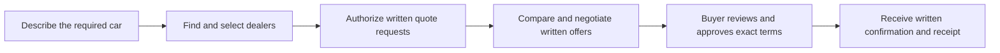

# Sealed: A Buyer-Controlled AI Assistant for Car-Dealer Negotiation

Project report | October 18, 2026

## Executive summary

Purchasing a car involves more than finding an attractive listing. A buyer must
identify suitable dealers, request comparable prices, clarify excluded fees,
follow up on unanswered messages and negotiate without losing control of the
decision. Managing these conversations separately can make the process demanding,
especially for buyers with limited time or negotiation experience.

Sealed is a project designed to support this process through an AI-assisted
negotiation workflow. The buyer describes the required car, chooses a public
target price and sets a private maximum acceptable price. The system helps find
dealers, requests written quotes, organizes their responses and carries out a
bounded negotiation. The buyer reviews the proposed deal and must approve its
exact terms before the system requests purchase paperwork.

The central design principle is that the buyer's private maximum should not
become a seller-facing negotiation signal. Sealed separates communication from
decision authority: Fo handles authorized communication, while application rules
control permitted facts, prices and actions. Written evidence supports quote
comparison, and the buyer retains the final decision.

A working local prototype has been implemented, including dealer discovery,
email outreach, quote extraction, call tracking, a dashboard and approval-based
completion. Automated and controlled demonstrations validate the main workflow.
Some individual integrations have also been exercised live. The complete live
journey and the latest call protocol still require supervised acceptance. The
project has not yet measured savings or time reduction in a real buyer study.

## 1. Introduction and background

Car buyers can research vehicles online, yet collecting and negotiating reliable
dealer offers remains a separate task. A displayed vehicle price may differ from
the amount payable after taxes, registration, dealer fees or additional products.
A useful comparison therefore requires a written out-the-door total for the
specified vehicle and clearly stated terms.

Digital convenience and buyer control are relevant needs. Cox Automotive's
January 2026 publication of its 2025 Car Buyer Journey Study reported that 37%
of buyers wanted to finalize the purchase price online, while 19% actually did
so. The study surveyed 2,300 recent new- and used-vehicle buyers. These results
describe a gap between preferred and actual purchase processes; they do not
measure demand for Sealed specifically. [Source 1](https://www.coxautoinc.com/insights/cox-automotive-car-buyer-journey-study-finds-efficiency-digital-tools-and-ai-drive-record-satisfaction/)

A separate Cox Automotive study published in August 2025 identified transparency,
feeling informed, supportive staff and control as important contributors to
shopper satisfaction. It also described waiting and finalizing terms among
stressful parts of the journey. This supports the project's emphasis on clear
offers and buyer approval. [Source 2](https://www.coxautoinc.com/press-releases/cox-automotive-unveils-key-insights-into-successful-car-deals-in-new-study-drivers-of-car-shopping-satisfaction/)

Sealed focuses on coordinating quote collection and negotiation before a buyer
commits. Test drives, inspections and the final transaction can still involve
direct interaction with the dealership.

## 2. Problem statement

**Car buyers lack a simple, buyer-controlled way to collect comparable written
offers from multiple dealers, manage follow-ups and negotiate toward a chosen
price while keeping their maximum willingness to pay private.**

The problem has several connected parts:

| Challenge | Effect on the buyer | Project response |
|---|---|---|
| Finding suitable sellers | The buyer may not know which nearby dealers to approach | Suggest dealers from public sources and let the buyer choose |
| Inconsistent quote formats | A listing price, monthly payment and all-in total cannot be compared directly | Request written out-the-door totals and flag incomplete terms |
| Repeated follow-ups | Separate emails and calls require attention and tracking | Coordinate authorized messages and bounded call nudges |
| Negotiation uncertainty | The buyer may struggle to decide what to say or which price to cite | Use a fixed strategy based on the public target and actual written quotes |
| Private budget exposure | Revealing the maximum can weaken the buyer's negotiating position | Keep the ceiling separate from external communication |
| Trust in automation | An assistant could overstate facts or act beyond the buyer's intent | Check communication, preserve evidence and require exact-term approval |

These are the design problems addressed by the prototype. Their frequency and
severity for Sealed's intended users still require direct user research.

## 3. Aim and objectives

The aim is to make multi-dealer quote collection and negotiation easier to manage
while preserving the buyer's privacy, understanding and authority.

The project objectives are to:

1. Accept a clear vehicle requirement, location, timeline and price preference.
2. Support buyers who already know dealers and buyers who need help finding them.
3. Collect written totals with enough context for meaningful comparison.
4. Reduce manual coordination through authorized email and phone communication.
5. Negotiate using truthful, supported prices within a fixed round plan.
6. Keep the private ceiling outside Fo, seller communication and quote-extraction
   model inputs.
7. Explain progress, incomplete evidence and review needs through one dashboard.
8. Require approval before requesting purchase paperwork and written confirmation
   before displaying completion.
9. Preserve progress across interruptions without blindly repeating outreach.

The desired outcome is an informed decision supported by documented offers.
Achieving the target price depends on seller responses and is not guaranteed.

## 4. Intended users and project scope

### Intended users

The initial users are individual car buyers who know their approximate vehicle
requirements but want help coordinating dealer conversations. Examples include
first-time buyers, students and recent graduates, busy professionals, and buyers
who prefer to compare written terms before visiting a dealership. These groups
are proposed users; the project has not yet validated adoption within them.

Dealership staff are the communication counterpart. Clear specifications and
genuine purchase intent can help them respond with relevant written terms.

### Current scope

The prototype supports one vehicle requirement, up to five sellers, a US ZIP-based
dealer search of approximately 20 miles, email and authorized calls, and exactly
two negotiation rounds. A user can enter sellers manually or choose researched
candidates. The application currently runs locally.

The project does not execute payments, complete financing, inspect vehicles,
verify legal title or independently certify inventory. For used cars, mileage,
condition, history and equipment can make offers materially different even when
the model and year match. The buyer must review those differences; an apparently
lower total alone does not establish the better vehicle.

## 5. Existing approaches and the remaining gap

Buyers can already combine several approaches. The following comparison concerns
types of workflow, not a claim that every product in a category behaves alike.

| Approach | What it helps with | Work that can remain for the buyer |
|---|---|---|
| Listing and search websites | Discovering vehicles and advertised prices | Confirming availability, obtaining final totals and following up |
| Direct dealer email and phone calls | Obtaining information from the seller | Tracking multiple conversations and negotiating consistently |
| Personal spreadsheets and notes | Recording quotes in one place | Entering terms, checking evidence and taking every next action |
| General AI assistance | Explaining concepts and drafting messages | Connecting communication to verified evidence and approval controls |
| Sealed's proposed workflow | Joining discovery, written offers, bounded communication and buyer approval | Reviewing exceptions, assessing the car and deciding whether to proceed |

The project opportunity is to bring these coordination steps together. Its value
proposition is a manageable, documented buying process with explicit limits on
what the assistant may decide and communicate. Broad superiority over existing
services has not been established through comparative testing.

## 6. Proposed solution and guiding principles

Sealed provides a single workspace for the buyer's requirements, selected dealers,
messages, quotes, negotiation status and final decision. An external assistant,
Fo, performs authorized communication. Sealed supplies the permitted public facts
and checks the proposed communication before allowing the next action.

Two price concepts are deliberately separated:

- **Public target:** the price the buyer would like to obtain. This may be used
  in a counteroffer.
- **Private ceiling:** the maximum used inside the backend when deciding whether
  a written offer is eligible to be proposed. It is not sent to Fo or sellers.

The system follows four guiding principles. Communication should use supported
facts; comparable prices should come from written seller evidence; automation
should have bounded actions; and a purchase decision should remain with the
buyer. A call's spoken price is not treated as a firm written offer.

Email wording is generated within these limits rather than prescribed word for
word. Code checks routing, required details, allowed prices and commitments.
Calls similarly require a checked plan containing the buyer identity, number,
opening and task before a separate dialing permission is issued.

These checks reduce tested failure modes. They do not prove every possible
natural-language statement correct or mechanically restrict all of Fo's tools.

## 7. User journey and illustrative scenario

### Stage 1: Describe the purchase

The buyer enters the car specification, ZIP, deadline, public target and private
ceiling. More precise requirements improve the relevance of seller responses.
Creating the negotiation alone contacts nobody.

### Stage 2: Choose dealers

The buyer adds known dealers or authorizes public dealer research. Suggested
contacts are checked against published sources, and the buyer selects whom to
approach. Discovery is distinct from permission to contact sellers.

### Stage 3: Collect written offers

After authorization, Fo asks for written out-the-door totals. Incomplete replies
can receive one clarification request. An eligible silent seller can receive an
authorized call asking for a written response.

### Stage 4: Compare and negotiate

The system evaluates supported written terms. Higher-priced sellers may be told
the lowest genuine competing written total; a seller holding the lowest quote
may receive a counter at the buyer's public target. The fixed plan does not
increase offers toward the private ceiling.

### Stage 5: Review the proposal

The buyer sees the seller, amount, delivery terms, supporting evidence and flags.
The buyer can approve the exact proposal, reject it or cancel. Eligibility within
the private ceiling does not automatically authorize the purchase.

### Stage 6: Obtain written confirmation

Approval permits a request for paperwork at the agreed terms. The system waits
for the seller's matching written confirmation before showing completion and a
receipt. No payment is made through this workflow.

### Illustrative buyer scenario

A buyer seeks a Honda CR-V around model year 2015 and chooses a public target of
$10,000. The buyer privately sets a maximum and selects several dealers. One
seller replies with an asking price without fees, another provides a complete
written total, and a third does not respond.

Sealed requests clarification from the first seller, retains the supported offer
from the second and can use an authorized call nudge for the third. It negotiates
only after appropriate written evidence exists. At the end of the rounds, it
shows a qualifying offer or explains that review is needed. The buyer still
checks mileage, condition, vehicle history and suitability before proceeding.

This scenario explains intended behavior. It is not a record of a completed
Honda purchase or evidence that a dealer accepted $10,000.

## 8. Main features and user experience

| Feature | Purpose for the user |
|---|---|
| Requirements and pricing form | Describe the purchase once and distinguish target from private maximum |
| Dealer discovery and manual entry | Start even when the buyer has no existing dealer list |
| Written quote collection | Obtain a clearer basis for comparison than an advertised price alone |
| Quote clarification | Identify missing fees, specification details or other unsupported terms |
| Bounded negotiation | Carry out consistent, truthful counters and price-match requests |
| Call progress and outcomes | Show when a call result is pending and what Fo later reports |
| Dealer history | Review the messages, replies, decisions and evidence for each seller |
| Alerts and review states | Make uncertainty visible instead of silently continuing |
| Proposal approval and rejection | Preserve the buyer's control over the final terms |
| Final receipt and fee comparison | Summarize the written outcome and available itemized costs |

The dashboard uses a pinned summary and a next-step card to explain what is
happening. Overview, Dealers, Activity and Receipt tabs organize the details.
The private ceiling can be displayed through a separate endpoint and is kept out
of event history and browser storage. Backend restart can require the buyer to
restore that value before new actions continue.

## 9. Development approach and system overview

Development proceeded in stages: define the buying problem and trust boundaries;
build the negotiation rules; connect controlled communication; validate written
replies; add durable processing and a background worker; connect the dashboard;
then improve dealer discovery, review handling and call progress.

The application combines a React dashboard with a Python/FastAPI backend. SQLite
holds public job progress, evidence references and pending actions. Fo supplies
communication and public research through MCP. Gmail supplies written message
evidence. A separate Claude extraction step turns authorized seller text into
structured terms, which application code validates.

The key division of responsibility is organizational as well as technical: the
buyer defines the task and approves a proposal; Sealed controls the permitted
workflow; Fo communicates within the authorized task; and written seller evidence
supports the comparison. The private ceiling remains in backend memory.

The team integrated Renu's dashboard contributions and extended them with clearer
discovery states, call progress, final outcomes and a corrected review indicator.
Implementation details and module-level evidence are documented separately in the
technical progress report.

## 10. Implementation status and evaluation

The current deliverable is a working local prototype. Its major workflow stages
are implemented, but implementation, synthetic validation and live acceptance
represent different levels of evidence.

| Area | Evidence available | Interpretation |
|---|---|---|
| Core negotiation and approval | Complete synthetic runs with written confirmation and replay checks | The implemented workflow can reach a controlled final outcome |
| Email communication | Controlled live sends and a target-price counter checked against Gmail evidence | Individual outreach and auditing paths have worked live |
| Quote extraction | One authorized live sample, plus automated validation tests | Missing specification evidence correctly prevents a firm result |
| Dealer research | Historical live research and checked candidates, plus simulated discovery tests | Candidate discovery works; stock and fresh availability remain unconfirmed |
| Call lifecycle | Automated checks and synthetic browser updates | The new checked-plan protocol still needs a fresh consenting live call |
| Dashboard | Browser checks of progress, activity, approval and receipt views | The tested interface displays the expected state transitions |

The recorded automated checks include 586 passing backend tests, 9 passing
frontend tests, a successful production build and lint checks. Browser testing
confirmed pending call display, a final reported no-answer outcome, activity
updates and a synthetic final receipt. Tested mobile views had no horizontal
overflow.

A controlled synthetic negotiation used a $100 written quote and $90 public
target, followed by explicit simulated approval and written confirmation. Those
sample values demonstrate system behavior. They are not measured car-purchase
savings or proof of market performance.

The evaluation has not yet included a representative buyer study, an independent
audit of all Fo actions, or a complete new live dashboard journey from discovery
to the seller's final written confirmation.

## 11. Expected benefits and measures of success

Sealed is intended to reduce repetitive coordination, improve the readability of
offers and give the buyer a clearer decision trail. Keeping the private ceiling
out of seller communication is intended to preserve negotiating discretion.
Requiring written evidence and approval is intended to improve confidence in what
the system presents.

These are expected benefits. Real time savings, purchase savings, adoption and
satisfaction have not yet been quantified for this project.

| Evaluation question | Proposed measure |
|---|---|
| Does it reduce manual effort? | Buyer time spent and number of manual follow-ups versus the buyer's normal process |
| Does it improve quote quality? | Share of responses with complete, comparable written terms |
| Is communication reliable? | Correct-recipient deliveries, duplicate actions, unresolved attempts and successful recovery |
| Does the buyer understand the result? | Ability to identify the seller, total, conditions and reason for a review flag |
| Does the privacy design hold? | Observed ceiling disclosures and unauthorized price or commitment statements in tested communications |
| Does it improve the purchase outcome? | Final confirmed terms compared with an appropriate documented baseline for the same purchase |

Both successful and unsuccessful negotiations should be included in future
evaluation. Savings comparisons must account for changes in vehicle condition,
fees and terms rather than comparing unrelated advertised prices.

## 12. Limitations and practical considerations

Seller participation is outside the application's control. Some dealers may not
reply, may prefer direct contact, or may decline the requested price. The two-round
plan can finish without a qualifying offer.

Discovery depends on public information. Website access restrictions can exclude
valid dealers, and an accessible listing does not prove stock. The 20-mile filter
uses approximate ZIP-centroid distances rather than driving distance.

Written terms can be incomplete or ambiguous. Unsupported extraction is held for
review. Phone-only sellers also need a trusted written identity handoff before
an unknown email can count as authenticated dealer evidence.

An earlier live call exposed a buyer-name mismatch and an unclear progress
response. The new checked call plan and result lifecycle address those tested
failure modes, but await fresh live acceptance. Identity and follow-up checks
rely on Fo-reported evidence; they are not independent voice or scheduler audits.

The current application is local and has no multi-user sign-in system. Hosted
operation would require additional account isolation and deployment work. A
backend restart clears the private ceiling. Cancelling a negotiation stops queued
application actions but cannot recall an external call already underway.

Finally, communication checks and model extraction do not replace the buyer's
assessment of the vehicle, financing, contract or final purchase paperwork.

## 13. Future scope and development priorities

### Immediate validation

The next priority is a consenting one-call acceptance that confirms the correct
buyer identity, a single dialing permission, visible progress and a usable final
report. This should be followed by a complete controlled live negotiation through
written quote, counter, buyer approval and written confirmation. Restart and
review handling should be exercised during that acceptance.

### Product improvements

Further work can improve guided vehicle requirements, explain why a quote is
incomplete, make review actions easier to understand and establish a clearer
trusted-contact onboarding process for phone-only dealers. User interviews and
observed tasks should inform those changes.

### Broader deployment and evaluation

A hosted version would need user authentication, per-account separation and
operational recovery appropriate to real users. A pilot should measure effort,
quote completeness and decision confidence before making claims about savings.
Service costs and support requirements should also be measured before selecting
a pricing model; the project currently has no validated revenue model.

### Longer-term possibilities

The workflow may later apply to other purchases where specifications and written
offers can be compared meaningfully. This would require domain-specific rules.
Vehicle history, inspection workflows, richer location filtering and more
detailed cost comparison are possible extensions rather than completed features.

## 14. Conclusion

Sealed addresses the coordination work between deciding what car to buy and
receiving a clear, acceptable written offer. It combines dealer selection,
authorized communication, evidence-based quote comparison and a bounded
negotiation process while preserving the buyer's final approval.

The project demonstrates a working local workflow and several successful
individual live integration checks. Its strongest contribution is the combination
of a private-ceiling boundary, supported negotiation facts, visible progress and
explicit approval. Completing controlled live acceptance and testing with buyers
are the next steps toward establishing its practical value.

## 15. References and evidence basis

1. Cox Automotive. *Car Buyer Journey Study Finds Efficiency, Digital Tools and
   AI Drive Record Satisfaction.* January 13, 2026; reporting research conducted
   in fall 2025. [Read the study announcement](https://www.coxautoinc.com/insights/cox-automotive-car-buyer-journey-study-finds-efficiency-digital-tools-and-ai-drive-record-satisfaction/).
2. Cox Automotive. *Key Insights into Successful Car Deals: Drivers of Car
   Shopping Satisfaction.* August 26, 2025.
   [Read the study announcement](https://www.coxautoinc.com/press-releases/cox-automotive-unveils-key-insights-into-successful-car-deals-in-new-study-drivers-of-car-shopping-satisfaction/).
3. Sealed project. *Implementation and validation report.* October 18, 2026.
   Repository document: `docs/progress_report_2026-10-18.md`.
4. Sealed project. Architecture, dashboard, quote parsing, dealer discovery and
   call lifecycle documentation; current source and recorded test evidence at
   implementation snapshot `941a591`.

External studies provide background context. Project results derive from the
repository and recorded controlled tests. The persona and Honda example are
illustrative; proposed benefits and future features are identified as such.
