# Sealed system flow

Current implementation: dealer selection through written confirmation, including privacy boundaries and recovery.

[Five architecture use cases and required adaptations](use_cases.md)

**Diagram key:** green highlights Fo / Wajo actions; amber highlights the private zone; red highlights waiting or review paths. Arrows show permitted paths, not a promise that a seller will reply or accept the target.

## 1. Complete system overview

[Open full-size SVG](diagrams/system_flow.svg) · [Editable Mermaid source](diagrams/system_flow.mmd)

- **Public inputs:** car specification, location, deadline and permitted prices.
- **Private input:** ceiling in backend memory, available only to private checks and qualification.
- **External communication:** Fo / Wajo research, email and authorized calls.
- **Evidence:** Gmail supplies written replies; Claude extracts terms without acting tools.
- **Completion:** the buyer approves exact terms, then the seller confirms them in writing.

## 2. Dealer discovery and job creation

[Open full-size SVG](diagrams/discovery_flow.svg) · [Editable source](diagrams/discovery_flow.mmd)

| Boundary | Details |
|---|---|
| Discovery input | Item, exact public specification, ZIP and radius; no target, ceiling or buyer identity |
| Candidate validation | Public HTTPS source reads, literal contacts, deduplication and independent ZIP-centroid distance |
| Selection | Up to five sellers; discovered contacts must match saved provenance and one-hour freshness |
| Research permission | Separate from permission to contact sellers |
| Uncertain attempts | Reuse the saved attempt; do not repeat the original request |
| Previously blocked search | Explicit resubmission may requeue only a search that never reached Fo after the blocking reservation is reviewed |

See [discovery operation](dealer_discovery.md).

## 3. Email and call dispatch

[Open full-size SVG](diagrams/outreach_flow.svg) · [Editable source](diagrams/outreach_flow.mmd)

- **Before either channel:** check authorization, private readiness, current quote authority and the outbound guard; persist the dispatch claim.
- **Email:** public brief → checked draft → persisted draft → confirmation → actual Gmail sent-copy audit → trusted reply bindings.
- **Call:** plan-only request → exact plan check → pending reservation → one dialing permission → read-only observation → scoped reported result.
- **Pending call:** publish progress, hold later account outreach and timers, and observe the same conversation.
- **Call review:** check buyer/phone/request scope, introduction, full reported transcript, permitted numbers, commitments and follow-ups.
- **Deadline:** a call lacking a usable final result after 30 minutes requires review.

The branches can also stop on refusal, integration failure or unsupported output. Observing an existing attempt never grants another outreach permission.

See [email briefs](fo_briefs.md), [sent-copy auditing](sent_audit.md) and [call lifecycle](calls.md).

## 4. Written evidence and fixed-round negotiation

[Open full-size SVG](diagrams/quote_negotiation_flow.svg) · [Editable source](diagrams/quote_negotiation_flow.mmd)

| Step | Rule |
|---|---|
| Identity | Authenticate the seller and associate the reply with the correct account/job/run |
| Extraction | Authorized cleaned text and public parsing context only; no target, ceiling, contacts or acting tools |
| Validation | Check literal amounts, price roles, specification, all-in wording, dates, expiry and itemized costs |
| Firmness | The ledger determines whether the current authenticated written terms qualify as firm |
| Ordering | Newer written terms supersede older terms; stale replies cannot restore an obsolete offer |
| Transaction | Commit reply effects, public state and outbox intents before acknowledging the staged inbox item |
| Round 1 | Request written quotes, clarify once, and apply fixed waits for eligible call nudges |
| Round 2 | Cite genuine lower competing written totals or counter at the fixed public target |
| Qualification | After fixed rounds, privately choose a qualifying current written offer or request review |

The arrows returning to ingestion represent subsequent seller replies. They do not create unlimited negotiation rounds. A call's spoken price never becomes a firm ledger offer. Missing model evidence produces a non-firm/review result; parser failure can pause processing.

See [Gmail ingestion](gmail_ingestion.md), [quote parser](quote_parser.md), [durable delivery](reply_delivery.md) and [coordinator](coordinator.md).

## 5. Approval, completion and recovery

[Open full-size SVG](diagrams/approval_recovery_flow.svg) · [Editable source](diagrams/approval_recovery_flow.mmd)

- **Approval:** exact current proposal terms, valid quote, private runtime and settled integration checks.
- **Paperwork:** queue only after approval; other sellers' declines wait for the checked booking send result.
- **Completion:** authenticate and link the seller's written confirmation to the actual paperwork request, then check the approved terms.
- **Rejection:** the same rejected offer is not automatically proposed again; a new firm written offer may trigger qualification.
- **Cancellation:** stop queued actions; an in-flight external action cannot be recalled by cancelling the job.
- **Restart:** reuse durable attempts and public state; restore the ceiling for eligible new actions.
- **Operator release:** limited to a reviewed uncertain call. It does not resume the engine, repair arbitrary outbox claims or permit another send.

See [approval API](api.md), [worker recovery](coordinator.md) and [operator call review](call_review.md).

## Data and trust boundaries

| Component | Receives | Excludes or limits |
|---|---|---|
| User dashboard | Own requirements, own ceiling, evidence and progress | No Fo credentials or direct provider connection |
| Private zone | Ceiling, candidate quote and disclosure-check text | Returns qualification or pass/fail; no numeric budget gap |
| Strategy and coordinator | Public job, fixed timers, written ledger and injected private callbacks | No ceiling parameter; outgoing offers are not derived from it |
| Fo discovery | Public item/specification/ZIP/radius | No target, ceiling or buyer identity |
| Fo outreach | Action-specific public facts, routing, buyer identity and allowed price roles | No ceiling or unrestricted authority to negotiate, schedule, pay or book |
| Claude parser | Authorized cleaned reply and limited public parsing context | No target, ceiling, contacts or tools |
| Persistent application state | Public checkpoints, evidence, events, cache and scoped claims | No private ceiling; raw call transcripts stay in ignored local Fo state |

**Provider limits:** Fo research restrictions and call constraints are instructions plus checks on reported evidence. They are not a mechanical sandbox or independent voice/scheduler attestation. The checked call protocol and full live dashboard journey still need fresh live acceptance.

Simulation replaces the external integrations with synthetic implementations while retaining the durable engine and approval gates. The diagrams describe paths and controls, not independently verified real-world outcomes.
